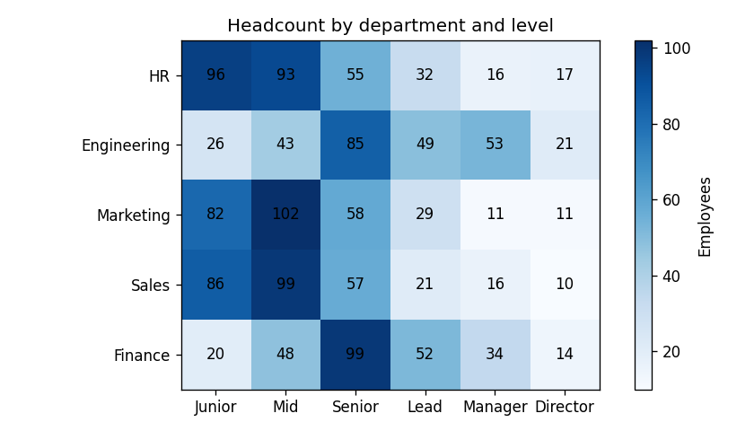
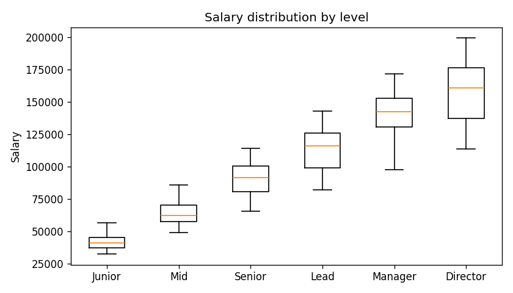
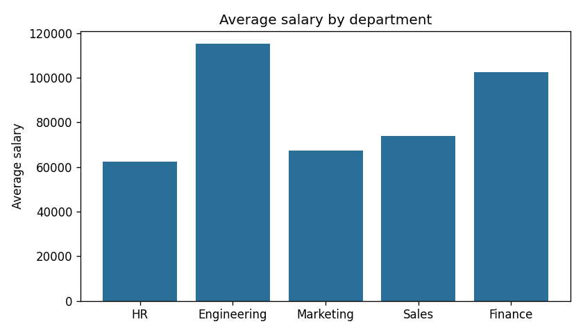
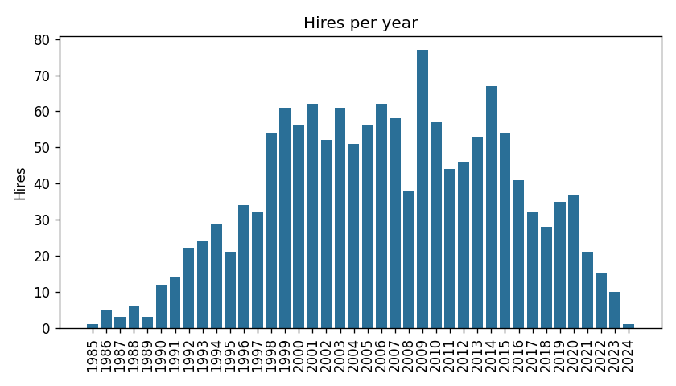

# Analysis report

## 1. More than 5 years with the company
1405 employees, of which 435 have a start date flagged in `data_quality_issues`, so their tenure is unreliable. First 10 by start date:

| Id | First name | Last name | Department | Level | Started | Years | Valid start date |
|---|---|---|---|---|---|---|---|
| 683 | Phillip | Williams | Finance | Director | 1985-10-11 | 41 | 0 |
| 360 | Ricky | Hill | HR | Director | 1986-03-09 | 40 | 0 |
| 473 | Joseph | Martin | HR | Manager | 1986-08-21 | 40 | 0 |
| 1162 | Sean | French | Engineering | Director | 1986-08-23 | 40 | 1 |
| 1342 | Michael | Aguilar | HR | Director | 1986-09-12 | 40 | 0 |
| 799 | Laurie | Wright | Sales | Director | 1986-09-15 | 40 | 0 |
| 912 | Stephanie | Davis | Sales | Director | 1987-07-13 | 39 | 0 |
| 369 | Virginia | Johnson | Engineering | Director | 1987-09-14 | 39 | 0 |
| 1144 | Andrea | Arnold | Finance | Manager | 1987-09-19 | 39 | 0 |
| 150 | Suzanne | Walsh | HR | Director | 1988-02-04 | 38 | 0 |

## 2. Average salary by department and level
| Department | Level | Employees | Average salary |
|---|---|---|---|
| HR | Junior | 96 | 36014.04 |
| HR | Mid | 93 | 54815.06 |
| HR | Senior | 55 | 72694.15 |
| HR | Lead | 32 | 89933.38 |
| HR | Manager | 16 | 107569.00 |
| HR | Director | 17 | 125877.29 |
| Engineering | Junior | 26 | 50963.96 |
| Engineering | Mid | 43 | 77919.81 |
| Engineering | Senior | 85 | 104262.72 |
| Engineering | Lead | 49 | 129481.20 |
| Engineering | Manager | 53 | 154574.19 |
| Engineering | Director | 21 | 182985.76 |
| Marketing | Junior | 82 | 39794.18 |
| Marketing | Mid | 102 | 60039.05 |
| Marketing | Senior | 58 | 79504.67 |
| Marketing | Lead | 29 | 99794.76 |
| Marketing | Manager | 11 | 117745.91 |
| Marketing | Director | 11 | 141272.27 |
| Sales | Junior | 86 | 43833.26 |
| Sales | Mid | 99 | 66201.26 |
| Sales | Senior | 57 | 88190.39 |
| Sales | Lead | 21 | 111050.33 |
| Sales | Manager | 16 | 134275.94 |
| Sales | Director | 10 | 154433.70 |
| Finance | Junior | 20 | 47567.75 |
| Finance | Mid | 48 | 72187.46 |
| Finance | Senior | 99 | 96283.70 |
| Finance | Lead | 52 | 120702.13 |
| Finance | Manager | 34 | 141797.85 |
| Finance | Director | 14 | 168704.79 |

## 3. Top 5 highest-paid employees
| Id | First name | Last name | Department | Level | Salary |
|---|---|---|---|---|---|
| 776 | Jennifer | Anderson | Engineering | Director | 199203.00 |
| 708 | Diane | Smith | Engineering | Director | 198942.00 |
| 1001 | Daniel | Murphy | Engineering | Director | 198538.00 |
| 457 | Tamara | Gutierrez | Engineering | Director | 198456.00 |
| 392 | Michael | Carlson | Engineering | Director | 197368.00 |

## 4. Employees by department and level
| Department | Junior | Mid | Senior | Lead | Manager | Director |
|---|---|---|---|---|---|---|
| HR | 96 | 93 | 55 | 32 | 16 | 17 |
| Engineering | 26 | 43 | 85 | 49 | 53 | 21 |
| Marketing | 82 | 102 | 58 | 29 | 11 | 11 |
| Sales | 86 | 99 | 57 | 21 | 16 | 10 |
| Finance | 20 | 48 | 99 | 52 | 34 | 14 |

## 5. Salary by level
| Level | Employees | Min | Average | Max |
|---|---|---|---|---|
| Junior | 310 | 32414.00 | 41182 | 56202.00 |
| Mid | 385 | 48676.00 | 63873 | 85652.00 |
| Senior | 354 | 65470.00 | 90482 | 114121.00 |
| Lead | 183 | 81782.00 | 113252 | 142907.00 |
| Manager | 130 | 97486.00 | 139833 | 171411.00 |
| Director | 73 | 113406.00 | 156751 | 199203.00 |

## 6. Average salary by department

## 7. Hires per year
| Year | Hires |
|---|---|
| 1985 | 1 |
| 1986 | 5 |
| 1987 | 3 |
| 1988 | 6 |
| 1989 | 3 |
| 1990 | 12 |
| 1991 | 14 |
| 1992 | 22 |
| 1993 | 24 |
| 1994 | 29 |
| 1995 | 21 |
| 1996 | 34 |
| 1997 | 32 |
| 1998 | 54 |
| 1999 | 61 |
| 2000 | 56 |
| 2001 | 62 |
| 2002 | 52 |
| 2003 | 61 |
| 2004 | 51 |
| 2005 | 56 |
| 2006 | 62 |
| 2007 | 58 |
| 2008 | 38 |
| 2009 | 77 |
| 2010 | 57 |
| 2011 | 44 |
| 2012 | 46 |
| 2013 | 53 |
| 2014 | 67 |
| 2015 | 54 |
| 2016 | 41 |
| 2017 | 32 |
| 2018 | 28 |
| 2019 | 35 |
| 2020 | 37 |
| 2021 | 21 |
| 2022 | 15 |
| 2023 | 10 |
| 2024 | 1 |

